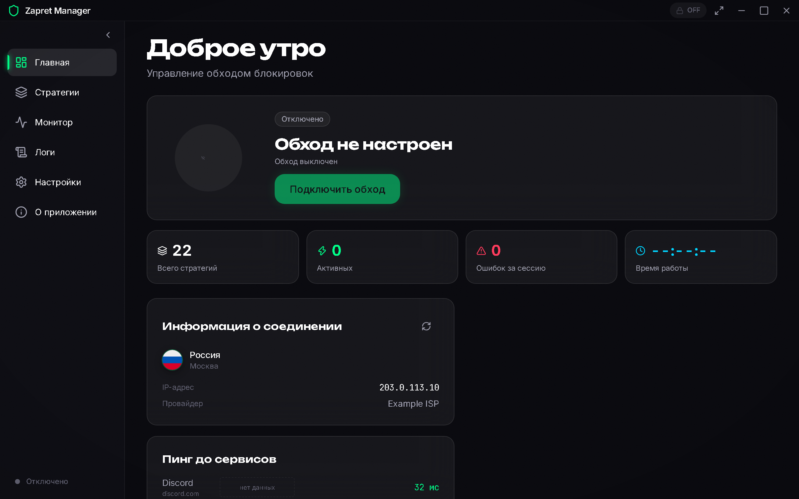
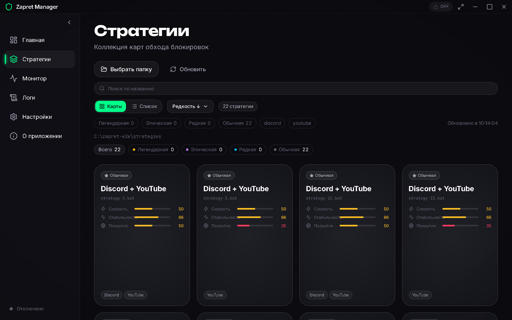
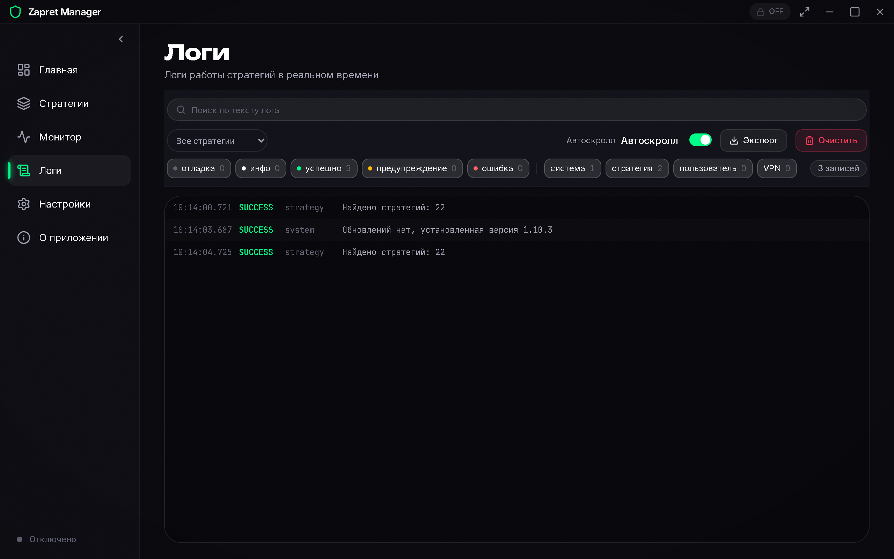
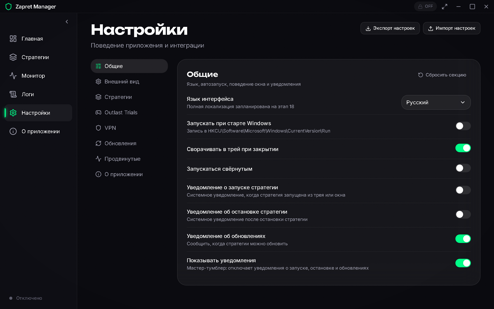

<div align="center">

# Zapret Manager

**Десктопное приложение для управления стратегиями обхода блокировок**

Discord · YouTube · Outlast Trials

[](https://github.com/USER/zapret-manager/actions/workflows/ci.yml)
[](https://github.com/USER/zapret-manager/releases)
[](LICENSE)

[Скачать](https://github.com/USER/zapret-manager/releases/latest) ·
[Установка](zapret-manager/docs/INSTALL.md) ·
[Сообщить о баге](https://github.com/USER/zapret-manager/issues)

</div>

---

## Что это

Zapret Manager — приложение для управления стратегиями обхода блокировок на основе
[zapret](https://github.com/bol-van/zapret). Оно даёт графический интерфейс для запуска,
мониторинга и управления `.bat`-стратегиями, а также умеет переключаться на VPN
(WireGuard / AmneziaWG), когда режим обхода через DPI не помогает.

## Возможности

- 🎮 **Игровой режим** — стратегии как «карты» с характеристиками и редкостью
- 📊 **Визуализатор трафика** — живые графики, счётчики и пинг в реальном времени
- 🚀 **Быстрый запуск** — одна кнопка на карточке стратегии
- 🛡️ **VPN-режим** — переключение между DPI-обходом и VPN с kill switch
- 🎯 **Outlast Trials** — автоматическое добавление доменов игры в конфиги
- 🔄 **Обновление стратегий** — из GitHub Releases, с бэкапами и откатом
- 📝 **Логи в реальном времени** — фильтры, поиск с подсветкой, экспорт
- 🎨 **Тёмная тема** — glassmorphism, bloom, vignette, RU/EN
- ⚡ **Быстро** — 60 FPS, холодный старт < 1.5 с
- 🔒 **Безопасно** — валидация данных, защита от injection и path traversal

## Скриншоты

| Dashboard                                                   | Стратегии                                                     |
| ----------------------------------------------------------- | ------------------------------------------------------------- |
|  |  |

| Логи                                              | Настройки                                                 |
| ------------------------------------------------- | --------------------------------------------------------- |
|  |  |

## Установка

### Системные требования

- Windows 10 (1809+) или Windows 11
- 200 MB свободного места
- WebView2 Runtime (обычно уже установлен в Windows 11)

### Шаги

1. Скачайте последний релиз: [Releases](https://github.com/USER/zapret-manager/releases/latest)
2. Запустите `ZapretManager_<версия>_x64-setup.exe` (или `.msi`, если нужна установка через Group Policy)
3. Следуйте инструкциям установщика

Подробности, включая portable-версию и проверку контрольных сумм — в
[docs/INSTALL.md](zapret-manager/docs/INSTALL.md).

## Быстрый старт

1. **Откройте приложение** — на первом запуске распакуются встроенные ресурсы
2. **Выберите папку со стратегиями** — «Стратегии» → «Выбрать папку»
3. **Запустите стратегию** — кнопка ▶ на карточке
4. **Подтвердите UAC** — для запуска `winws.exe` нужны права администратора

## FAQ

### Почему UAC-запрос при запуске?

Приложение само не запускается с правами администратора: права запрашиваются только на момент
запуска стратегии, где нужен перехват трафика.

### Можно ли использовать VPN и DPI-обход одновременно?

Нет, это взаимоисключающие режимы. При переключении на VPN работающая стратегия останавливается
и наоборот.

### Где хранятся настройки и данные?

В `%APPDATA%\ZapretManager\`: настройки, папка стратегий, логи, бэкапы обновлений и
безопасность. При удалении приложения данные можно оставить или удалить через установщик.

### Почему приложение просит перезапустить компьютер?

После первого запуска устанавливаются драйверы WinDivert. Если драйвер уже был загружен другой
программой, Windows может попросить перезагрузку.

## Разработка

```bash
git clone https://github.com/USER/zapret-manager.git
cd zapret-discord-youtube/zapret-manager
pnpm install
pnpm exec playwright install chromium

pnpm dev                # фронтенд
pnpm tauri dev          # приложение
pnpm test               # unit-тесты
pnpm e2e                # E2E
cd src-tauri && cargo test
```

Гайд по релизам — [docs/RELEASING.md](zapret-manager/docs/RELEASING.md),
гайд по тестам — [docs/TESTING.md](zapret-manager/docs/TESTING.md).

## Лицензия

[MIT](LICENSE) · Сторонние лицензии доступны в приложении: «О приложении» → «Лицензии».

---

<div align="center">

Сделано с ❤️ для сообщества zapret

</div>
