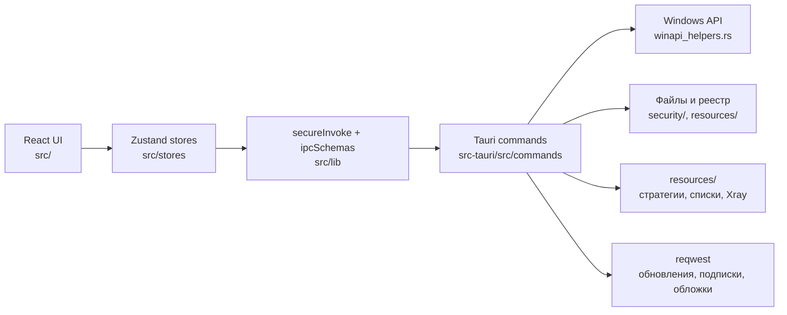

# Zapret Manager

Десктопное приложение для управления стратегиями обхода блокировок zapret на Windows.

[](CHANGELOG.md)
[](https://github.com/b1tn3zy2-arch/Zapret-Manager)
[](zapret-manager/src-tauri/installer/license.txt)
[](zapret-manager/package.json)
[](https://github.com/b1tn3zy2-arch/Zapret-Manager/actions/workflows/ci.yml)

> Актуально для релиза **1.0.2** (2026-11-23).

## Оглавление

- [Описание](#opisanie)
- [Возможности](#vozmozhnosti)
- [Стек и требования](#stek-i-trebovaniya)
- [Быстрый старт](#bystryi-start)
- [Установка](#ustanovka)
- [Настройка окружения](#nastroika-okruzheniya)
- [Использование](#ispolzovanie)
- [Архитектура](#arhitektura)
- [Сборка и релизы](#sborka-i-relizy)
- [Тестирование](#testirovanie)
- [Разработка и контрибьютинг](#razrabotka-i-kontribyuting)
- [CI/CD](#cicd)
- [FAQ и устранение неполадок](#faq-i-ustranenie-nepoladok)
- [Изменения и версии](#izmeneniya-i-versii)
- [Лицензия](#licenziya)
- [Поддержка](#podderzhka)
- [Благодарности](#blagodarnosti)

<a id="opisanie"></a>

## Описание

Zapret Manager — графическая оболочка для стратегий обхода блокировок `zapret`: она сканирует установленные игры, запускает и останавливает стратегии, показывает состояние соединения, трафик и логи, а также управляет VPN-подключением и подписками.

Приложение рассчитано на пользователей Windows, которые хотят управлять zapret без ручного редактирования `.bat`-файлов, и на разработчиков, которым нужен расширяемый десктопный каркас с тестами и воспроизводимой сборкой.

Проект поставляется вместе с ресурсами upstream-проекта [zapret-discord-youtube](https://github.com/Flowseal/zapret-discord-youtube) (стратегии, списки доменов и IP, Xray-core).

<a id="vozmozhnosti"></a>

## Возможности

- **Стратегии:** список встроенных стратегий (`resources/zapret/general-*.bat`), запуск/остановка, рейтинг и история запусков.
- **Мониторинг:** трафик в реальном времени, пинг до хостов из `PING_HOSTS`, состояние соединения и uptime.
- **Игры:** сканирование установленных игр, каталог известных игр, обложки, запуск игры с выбранной стратегией и отслеживание процесса.
- **Логи:** потоковый просмотр, фильтрация по уровню/стратегии, подсветка поиска и экспорт.
- **VPN:** подключение/отключение, статистика, kill-switch, управление подписками и платёжные сценарии.
- **Трей-меню:** отдельное окно `tray-menu` с быстрым переключением состояния и индикацией.
- **Обновления:** проверка версий по GitHub API, просмотр changelog, загрузка и применение обновлений с резервной копией.
- **Локализация:** русский и английский (`src/i18n/ru.ts`, `src/i18n/en.ts`).
- **Настройки:** шесть секций (`general`, `vpn`, `appearance`, `strategies`, `updates`, `advanced`), автозапуск и плотность интерфейса.

<a id="stek-i-trebovaniya"></a>

## Стек и требования

| Слой | Технология | Версия / источник |
| --- | --- | --- |
| UI | React, TypeScript | 19 / 6 — `zapret-manager/package.json` |
| Сборка UI | Vite, Tailwind CSS | 8 / 4 — `zapret-manager/vite.config.ts` |
| Состояние | Zustand, Immer | 5 / 11 — `zapret-manager/package.json` |
| Десктоп | Tauri | 2 — `zapret-manager/src-tauri/Cargo.toml` |
| Бэкенд | Rust | ≥ 1.98 (`rust-version`), сборка проверена на 1.100 |
| Тесты UI | Vitest, Playwright | 5 / 1.63+ — `vitest.config.ts`, `playwright.config.ts` |
| Пакеты | pnpm | 10 — `.github/workflows/ci.yml` |
| Node | Node.js | 22 — `.github/workflows/ci.yml` |

**ОС:** Windows 10 или новее. Проект использует Windows API, реестр, `netsh` и DirectX; сборка на Linux не поддерживается (см. комментарий в `.github/workflows/security.yml`).

**Инструменты для сборки из исходников:** Node.js 22, pnpm 10, Rust с target `x86_64-pc-windows-msvc` (`rust-toolchain.toml`), Visual Studio Build Tools с workload «Разработка классических приложений на C++» и Windows SDK. WebView2 Runtime в 설치щики встраивается автоматически (`webviewInstallMode: embedBootstrapper`, `silent: true` в `tauri.conf.json`).

**Для пользователя:** отдельно устанавливать Node, Rust и WebView2 не нужно — они нужны только при сборке из исходников.

<a id="bystryi-start"></a>

## Быстрый старт

```powershell
# 0. Получить исходники
git clone https://github.com/b1tn3zy2-arch/Zapret-Manager.git
cd Zapret-Manager

# 1. Подготовить инструменты (один раз)
corepack enable
corepack prepare pnpm@10 --activate
# Rust: https://rustup.rs  +  Visual Studio Build Tools (C++ и Windows SDK)

# 2. Установить зависимости
cd zapret-manager
pnpm install --frozen-lockfile

# 3. Запустить приложение в режиме разработки
pnpm tauri dev
```

Vite поднимает UI на `http://localhost:1420`, Tauri открывает главное окно `main`. Горячая перезагрузка работает через `TAURI_DEV_HOST`, если переменная задана.

Для запуска без Rust-бэкенда (только UI в браузере):

```powershell
pnpm dev
```

<a id="ustanovka"></a>

## Установка

### Из готового релиза

Релиз 1.0.2 лежит в `releases/v1.0.2/` (дублируется в `zapret-manager/release/`):

| Артефакт | Размер | Назначение |
| --- | --- | --- |
| `Zapret_1.0.2_x64-setup.exe` | 25,6 МБ | NSIS-установщик, русский и английский языки |
| `Zapret_1.0.2_x64_ru-RU.msi` | 28,25 МБ | MSI-установщик (русская локаль) |
| `ZapretManager_1.0.2_x64_portable.zip` | 25,5 МБ | Портативная версия: exe + `resources` + `icons` |
| `SHA256SUMS.txt` | — | Контрольные суммы трёх артефактов |

Проверка перед запуском:

```powershell
Get-Content .\releases\v1.0.2\SHA256SUMS.txt
Get-FileHash .\releases\v1.0.2\Zapret_1.0.2_x64-setup.exe -Algorithm SHA256
```

Портативный запуск:

```powershell
Expand-Archive .\releases\v1.0.2\ZapretManager_1.0.2_x64_portable.zip -DestinationPath .\zapret-portable
.\zapret-portable\zapret-manager.exe
```

Установщики NSIS и MSI запускаются двойным щелчком; режим установки NSIS — `both` (на пользователя или на машину).

### Из исходников

```powershell
pnpm install --frozen-lockfile
pnpm tauri build
```

Результат — бинарь `zapret-manager.exe` и установщики в `src-tauri/target/release/bundle/`.

<a id="nastroika-okruzheniya"></a>

## Настройка окружения

Приложение не требует обязательных переменных окружения. Переменные ниже влияют только на режим разработки и тестов.

| Переменная | Обязательна | По умолчанию | Назначение | Пример |
| --- | --- | --- | --- | --- |
| `TAURI_DEV_HOST` | Нет | не задана | Хост для Vite HMR при разработке через Tauri; включается в `vite.config.ts` | `127.0.0.1` |
| `TAURI_ENV_DEBUG` | Нет | не задана | Если задана, esbuild **не** удаляет `console`/`debugger` из dev-сборки | `1` |
| `VITE_PERF_MONITOR` | Нет | `0` | Значение `1` показывает `PerfMonitor` в `App.tsx`, только при `import.meta.env.DEV` | `1` |
| `CI` | Нет | не задана | Меняет поведение Playwright: `workers: 1`, 2 ретрая, репортер `line` | `true` |

```powershell
# Пример: включить оверлей производительности в dev-режиме
$env:VITE_PERF_MONITOR = "1"
pnpm dev
```

Основные пользовательские настройки хранятся не в окружении, а в `settings.json` каталога данных приложения; читают и пишут его `src/lib/storage.ts` с резервной копией `settings.json.bak`.

<a id="ispolzovanie"></a>

## Использование

### Команды разработки

Все команды выполняются из `zapret-manager/`.

| Команда | Что делает |
| --- | --- |
| `pnpm dev` | Vite dev-сервер на `localhost:1420` |
| `pnpm tauri dev` | Приложение с Rust-бэкендом и HMR |
| `pnpm build` | `tsc && vite build` → `dist/` |
| `pnpm build:check` | Сборка + `perf-check` + проверка защиты сборки |
| `pnpm typecheck` | `tsc --noEmit` |
| `pnpm lint` / `pnpm format` | ESLint / Prettier (write) |
| `pnpm format:check` | Проверка форматирования |
| `pnpm test` / `pnpm test:coverage` | Vitest / Vitest с покрытием |
| `pnpm e2e` | Playwright (chromium) |
| `pnpm cargo:check` | `cargo check` для `src-tauri` |
| `pnpm perf:check` | Лимиты размеров JS/CSS и главного чанка |
| `pnpm lint:dead` | Поиск мёртвого кода (knip) |
| `pnpm lint:i18n` | Сверка словарей и поиск хардкод-строк в UI |
| `pnpm lint:css` | Проверка CSS-контракта интерфейса |
| `pnpm lint:release` | Проверка метаданных релиза |
| `pnpm release:check` | Полный набор проверок перед релизом |
| `pnpm release:check:full` | Проверки + E2E + сборка + проверки бандла + `tauri build` |
| `pnpm release:local` | Проверки, `tauri build`, артефакты и SHA-256 |
| `pnpm bump` | Поднятие версии (`scripts/bump-version.mjs`) |

### Типовой сценарий

1. Запустите приложение (`pnpm tauri dev` или готовый релиз).
2. На вкладке **Стратегии** выберите стратегию и запустите её.
3. На вкладке **Мониторинг** наблюдайте трафик, пинг и состояние соединения.
4. На вкладке **Игры** найдите игру, назначьте стратегию и запустите её.
5. В трей-меню переключайте состояние, не открывая главное окно.

CLI-флагов у приложения нет: управление идёт через UI и переменные окружения из раздела выше.

### Пример конфигурации

Путей и формата настроек придерживается `src/lib/settingsSchema.ts`; запись идёт через `src/lib/storage.ts`:

```json
{
  "strategiesFolder": "",
  "lastStrategyId": "general-00-baseline",
  "general": {},
  "appearance": {},
  "strategyUpdates": {
    "ignoredVersions": [],
    "lastCheckAt": null
  },
  "games": [],
  "vpn": {},
  "advanced": {}
}
```

Пустые строки и пустые объекты означают «значение по умолчанию».

<a id="arhitektura"></a>

## Архитектура



| Каталог | Роль |
| --- | --- |
| `src/main.tsx`, `src/app/` | Точки входа; lazy-загрузка `App` и `TrayMenuRoot` |
| `src/pages/` | Экраны: Dashboard, Games, Logs, Monitor, Settings, Strategies, About |
| `src/components/`, `src/hooks/`, `src/stores/` | UI-компоненты, хуки, состояние |
| `src/lib/`, `src/types/`, `src/i18n/` | Утилиты, схемы IPC/Zod, словари ru/en |
| `src-tauri/src/main.rs`, `lib.rs` | Точка входа Rust и регистрация команд |
| `src-tauri/src/commands/` | Команды Tauri: стратегии, игры, VPN, логи, обновления, трей |
| `src-tauri/src/security/` | Проверка путей, URL, лимиты, DPAPI, санитизация |
| `src-tauri/src/strategy/`, `tray/` | Парсер/раннер стратегий, состояние трея |
| `src-tauri/resources/` | Стратегии, списки, Xray-core, обложки игр |
| `src-tauri/capabilities/` | Разрешения Tauri для главного окна и трей-меню |

Поток данных: UI → Zustand → `secureInvoke` → команда Tauri → Windows API/файлы/сеть → событие Tauri обратно в UI. Два окна (`main`, `tray-menu`) используют разные capability-наборы.

<a id="sborka-i-relizy"></a>

## Сборка и релизы

### Версионирование

Semver. Текущая версия **1.0.2** — patch-релиз: оптимизации и документирование без смены публичного API. Версия синхронизирована в `package.json`, `tauri.conf.json`, `Cargo.toml`, `Cargo.lock`, `APP_VERSION` и `scripts/build-bitmaps.js`; проверяется `pnpm lint:release`.

### Локальная сборка

```powershell
cd zapret-manager
pnpm release:check          # типы, линтеры, тесты, cargo test, clippy
pnpm tauri build            # NSIS + MSI
node scripts/release-artifacts.mjs   # копирование артефактов и SHA-256
```

Если `pnpm release:local` падает на Windows с `spawnSync pnpm ENOENT`, выполните три команды выше вручную — `scripts/release-local.mjs` использует `execFileSync("pnpm", ...)`, которому в таком окружении нужен `pnpm` в `PATHEXT`/PATH.

### Релиз через CI

1. Обновить версию во всех манифестах (`pnpm bump`) и добавить секцию в `CHANGELOG.md`.
2. Отправить тег `v1.0.2`.
3. `.github/workflows/release.yml` достанет заметки из CHANGELOG, выполнит `pnpm release:local`, проверит бандл и создаст **черновик** GitHub Release с артефактами.

Артефакты последнего релиза: [releases/v1.0.2](releases/v1.0.2).

<a id="testirovanie"></a>

## Тестирование

| Уровень | Команда | Что проверяет |
| --- | --- | --- |
| Типы | `pnpm typecheck` | Строгий TS (`tsconfig.json`) |
| Unit UI | `pnpm test` | Vitest, jsdom, `src/**/*.test.ts(x)` |
| Покрытие UI | `pnpm test:coverage` | v8, `src/lib/**` и `src/stores/**`; пороги 65/60/55/65 |
| E2E | `pnpm e2e` | Playwright, chromium, `e2e/*.spec.ts`, мок Tauri |
| Unit/integration Rust | `cargo test --manifest-path src-tauri/Cargo.toml` | Модули `commands/`, `strategy/`, `security/`, `tests/integration.rs` |
| Линтеры | `pnpm lint`, `pnpm cargo:check` | ESLint, TypeScript, cargo check |
| Clippy | `cargo clippy --manifest-path src-tauri/Cargo.toml --all-targets -- -D warnings` | Rust-линтер |
| Релизные проверки | `pnpm release:check:full` | Все проверки + E2E + сборка + бандл |

Перед первым E2E-запуском установите браузер:

```powershell
pnpm exec playwright install chromium
```

Фактические результаты последней проверки: Vitest — 46 файлов / 490 тестов; Rust — 831 unit + 14 integration; `cargo clippy` и `cargo fmt --check` — без замечаний.

Отдельного бенчмарка в репозитории нет; вместо него используется `pnpm perf:check` (лимиты gzip: JS ≤ 400 КБ, CSS ≤ 50 КБ, главный чанк ≤ 200 КБ) и `scripts/soak-check.mjs`.

<a id="razrabotka-i-kontribyuting"></a>

## Разработка и контрибьютинг

1. Сделайте форк/ветку от `main`.
2. Установите зависимости: `pnpm install --frozen-lockfile`.
3. Вносите изменения; обязательно прогоните `pnpm release:check` перед PR.
4. Оформляйте PR в `main`; CI должен быть зелёным (lint, типы, тесты, сборка).
5. Сохраняйте построчные комментарии в изменённых файлах — они часть текущего состояния кода.

Стиль кода фиксирован конфигурациями: Prettier (двойные кавычки, `;`, 2 пробела, 80 колонок, LF), ESLint (`eslint.config.js`), `rustfmt` и `clippy -D warnings`. Новые пользовательские строки в UI должны добавляться в `src/i18n/ru.ts` и `src/i18n/en.ts` — это проверяет `pnpm lint:i18n`.

<a id="cicd"></a>

## CI/CD

| Workflow | Триггеры | Что делает |
| --- | --- | --- |
| `.github/workflows/ci.yml` | `push`/`PR` в `main`, `workflow_dispatch` | typecheck, ESLint, Prettier, knip, i18n, CSS, release-metadata, Vitest+coverage, cargo test + clippy, Playwright E2E, `pnpm tauri build`, `perf-check`, `lint:protection`, `lint:bundle`, загрузка `release-candidate` |
| `.github/workflows/security.yml` | `push`/`PR` в `main`, `workflow_dispatch` | `cargo audit`, `pnpm audit --audit-level=high`, `scripts/security-audit.mjs`, TypeScript/ESLint, clippy, cargo test |
| `.github/workflows/release.yml` | тег `v*`, `workflow_dispatch` | заметки из CHANGELOG, `pnpm release:local`, проверки артефактов, черновик GitHub Release |

Статус: вкладка **Actions** репозитория [Zapret-Manager](https://github.com/b1tn3zy2-arch/Zapret-Manager/actions).

<a id="faq-i-ustranenie-nepoladok"></a>

## FAQ и устранение неполадок

### `pnpm: command not found`

Нужен Node.js 22 и pnpm 10: `corepack enable` и `corepack prepare pnpm@10 --activate`. Альтернатива — `npm install -g pnpm@10`.

### `cargo: command not found` или ошибка линковки

Установите Rust через [rustup](https://rustup.rs) (target `x86_64-pc-windows-msvc`, `rust-toolchain.toml`) и Visual Studio Build Tools с C++ workload и Windows SDK. Сборка на Linux не поддерживается.

### Приложение не запускается из-за WebView2

Сборка включает `embedBootstrapper` с тихой установкой WebView2. Если машина без доступа к сети во время установки, запустите установщик WebView2 Runtime вручную и повторите.

### E2E падают с «browser not found»

```powershell
pnpm exec playwright install chromium
```

### `pnpm release:local` падает с `spawnSync pnpm ENOENT`

Выполните шаги вручную: `pnpm tauri build`, затем `node scripts/release-artifacts.mjs`.

### Known issue: `verify-portable.mjs` сообщает «0 распакованных стратегий»

На машине с уже проинициализированным каталогом данных `verify-portable.mjs` может не найти `.bat` в `%APPDATA%\com.zapretmanager.app\strategies` при том, что exe успешно запускается (`ALIVE`). Проверка зависит от состояния окружения; стратегии поставляются в `resources/zapret/general-*.bat` внутри portable-архива.

<a id="izmeneniya-i-versii"></a>

## Изменения и версии

Полная история — [CHANGELOG.md](CHANGELOG.md).

| Версия | Дата | Ключевое изменение |
| --- | --- | --- |
| 1.0.2 | 2026-11-23 | Оптимизации, построчное документирование кода, новый релиз |
| 1.0.1 | 2026-11-21 | Ускорение поиска переводов (×60,9 в микробенчмарке), сборка MSI/NSIS/portable, синхронизация версий |
| 0.1.1 | — | Первый сохранённый установщик (MSI и NSIS) |

<a id="licenziya"></a>

## Лицензия

Сам Zapret Manager поставляется на условиях **Terms of Use** — «как есть», без гарантий: [`zapret-manager/src-tauri/installer/license.txt`](zapret-manager/src-tauri/installer/license.txt). SPDX-лицензия в манифестах не указана.

Сторонние компоненты со своими лицензиями:

| Компонент | Лицензия | Файл |
| --- | --- | --- |
| zapret | MIT | `zapret-manager/src-tauri/resources/zapret/LICENSE-zapret.txt` |
| WinDivert | LGPL v3 | — (бинарный компонент в `resources/zapret/bin/`) |
| cygwin1.dll | LGPL | — |
| Xray-core | MPL-2.0 | `zapret-manager/src-tauri/resources/vpn/LICENSE-xray.txt` |
| Microsoft Edge WebView2 | Лицензия Microsoft | — |

Полный список также доступен в UI: `src/components/settings/LicensesModal.tsx`.

<a id="podderzhka"></a>

## Поддержка

- Ошибки и предложения: [Issues](https://github.com/b1tn3zy2-arch/Zapret-Manager/issues).
- Вопросы по использованию: тот же раздел Issues.
- Уязвимости: сообщайте в Issues с пометкой `security`.

<a id="blagodarnosti"></a>

## Благодарности

- [Flowseal/zapret-discord-youtube](https://github.com/Flowseal/zapret-discord-youtube) — upstream-стратегии и списки.
- [bol-van/zapret](https://github.com/bol-van/zapret) — движок обхода блокировок.
- [XTLS/Xray-core](https://github.com/XTLS/Xray-core) — VPN-ядро.
- Сообщества [Tauri](https://github.com/tauri-apps/tauri), [React](https://github.com/facebook/react) и [Lucide](https://github.com/lucide-icons/lucide).
